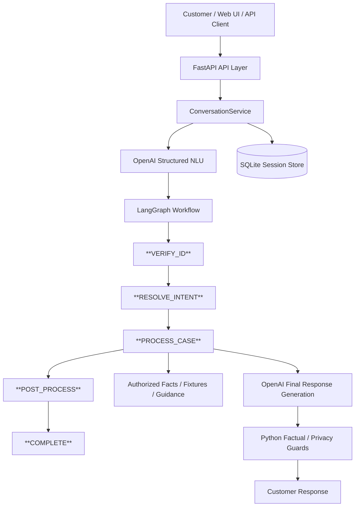

# SOP-Guided-Conversational-Agent-Meiqi

## Project idea

The project is an insurance claims support agent that combines the discipline of a fixed Standard Operating Procedure with the flexibility of a natural conversation. A fully rule-based chatbot would be safe but rigid, while a fully open-ended LLM chatbot could sound natural but might disclose private claim information, skip identity verification, or invent unsupported facts. This project combines both approaches: Python and LangGraph control the business process, while OpenAI understands the customer and writes the final response.

The main design goal is to make the agent conversational without allowing it to become an uncontrolled free-form chatbot.

## Why this design is needed

Insurance conversations contain sensitive information such as identity data, claim status, denial reasons, documents, payments, and appeal deadlines. The system therefore needs strict control at important boundaries:

- Claim information must remain hidden before identity verification.
- A verified customer must only access claims that belong to them.
- The agent must not replace a requested fact with a related but different fact.
- Email summaries require explicit consent.
- Out-of-scope questions should be declined instead of answered creatively.
- Emotional pressure should not cause the agent to bypass a required SOP step.

At the same time, real customers do not speak in predefined commands. They use incomplete sentences, follow-up questions, misspellings, frustration, and indirect language. OpenAI is useful for understanding those messages and expressing the answer naturally, while Python is better suited to authorization, state transitions, and factual checks.

## Most important functionality

The most important functionality is the controlled handoff between language intelligence and business logic:

```text
Customer message
        ↓
OpenAI Structured NLU
        ↓
Python / LangGraph workflow, authorization, and state management
        ↓
Authorized claim facts and deterministic answer draft
        ↓
OpenAI final response generation
        ↓
Python factual, privacy, and requested-field guards
        ↓
Customer response
```

OpenAI does not decide whether a customer is authorized to see a claim. Python does not need to handle every wording variation manually. Each part performs the task it is best suited for.

## Overall architecture



The main components are:

- **FastAPI:** exposes the chat API, health endpoint, configuration endpoint, reset endpoint, demo outbox endpoint, and browser UI.
- **ConversationService:** restores a session, invokes the workflow, persists the updated state, and returns the final response.
- **OpenAI Structured NLU:** extracts intent, requested fields, identity evidence, case hints, emotion, and workflow actions from the current message and conversation context.
- **LangGraph:** routes the session through the allowed SOP phases.
- **Repository and fixtures:** provide claim, policyholder, representative, consent, and document guidance data.
- **SQLite Store:** persists session state, revisions, expiration, and the demo email outbox.
- **Response generation layer:** asks OpenAI to turn authorized facts into a natural customer-facing response.
- **Guards:** check identity, claim ownership, factual grounding, privacy, and requested-field coverage before returning the response.

## The four workflow states

### 1. `VERIFY_ID`

This is the strictest state.

Main responsibilities:

- Collect identity evidence such as full name, date of birth, phone, email, or SSN last four digits.
- Require at least three matching identity fields before verification succeeds.
- Keep claim details hidden while verification is incomplete.
- Handle partial answers, corrections, refusals, alternate identity fields, and wrong values.
- Recognize frustration and explain why verification protects health and financial information.
- Remember useful case hints, such as “my denied healthcare claim from January,” without disclosing claim details.
- Offer human assistance after repeated verification resistance or failure.

Relevant code:

- `sop_agent_update/app/stages/verify_identity.py`
- `sop_agent_update/app/identity_guard.py`
- `sop_agent_update/app/repository.py`

### 2. `RESOLVE_INTENT`

This state is more flexible than identity verification, but authorization is still controlled by Python.

Main responsibilities:

- Interpret what the verified customer wants to know.
- Reuse case hints and questions remembered during `VERIFY_ID`.
- Resolve a claim from an explicit claim ID or from grounded case clues.
- Handle multiple claims and ask the customer to select the correct one when needed.
- Reject unsupported requests and route explicit human-transfer requests.
- Preserve the exact requested field instead of answering only a broad intent.

Relevant code:

- `sop_agent_update/app/stages/resolve_intent.py`
- `sop_agent_update/app/interpreter.py`
- `sop_agent_update/app/repository.py`

### 3. `PROCESS_CASE`

This state provides the main insurance support experience.

Main responsibilities:

- Answer questions about status, denial reasons, missing documents, submission, deadlines, payments, appeals, processing time, and next steps.
- Retrieve only facts from the authorized claim and approved guidance.
- Support compound questions and follow-up questions.
- Track `requested_fields`, `answered_fields`, and `pending_requested_fields`.
- Prevent a simple acknowledgement such as “thank you” from repeating a previous answer.
- Use OpenAI to make the response natural while preserving the Python-approved facts.
- Reject out-of-scope questions such as “What is RL?” politely.
- Offer a human representative after repeated irrelevant questions or high emotional distress.

Relevant code:

- `sop_agent_update/app/stages/process_case.py`
- `sop_agent_update/app/response_service.py`
- `sop_agent_update/app/guards_runtime.py`
- `sop_agent_update/app/factual_guard.py`

### 4. `POST_PROCESS`

This state handles follow-up and closure after the main claim question has been answered.

Main responsibilities:

- Ask whether the customer has any other questions.
- Return to `PROCESS_CASE` if the customer wants to continue.
- If there are no more questions, offer an email summary.
- Require an explicit send or skip decision.
- Include the claim outcome, discussed questions, and major follow-up items in the summary.
- Record the email action in the demo outbox.
- Close the conversation after the customer sends or skips the summary.

Relevant code:

- `sop_agent_update/app/stages/post_process.py`
- `sop_agent_update/app/store.py`

## Emotional Support and SOP recovery

Emotional Support is an important part of the design because insurance claims can involve medical bills, denied care, financial stress, and long waiting periods. A customer may be angry or overwhelmed while still needing a concrete claim answer.

The system therefore separates emotion from business intent. For example:

```text
Customer: I already told you who I am. This is ridiculous. Just tell me why my claim was denied.
```

The expected behavior is:

1. Recognize frustration.
2. Acknowledge the customer's concern.
3. Explain that claim information is protected and verification is required.
4. Offer the remaining acceptable identity options.
5. Continue toward verification without exposing claim details.
6. Offer human assistance if the customer continues to refuse or becomes highly distressed.

Emotional Support must never bypass identity verification, claim ownership, or email consent. It changes the tone and recovery strategy, not the security boundary.

## Scope control

The agent is designed for insurance claims support. It should not answer unrelated questions or become a general-purpose chatbot.

For an out-of-scope request such as “What is reinforcement learning?”, the agent politely redirects the customer to supported claim topics. The session records repeated out-of-scope attempts. After the configured threshold, the agent offers a human representative.

## Memory across phases

The session stores useful information when it is first mentioned, including:

- Identity evidence
- Claim ID and claim clues
- Claim type, status, month, and year
- Current intent
- Requested fields
- Answered fields
- Pending fields
- Conversation history
- Emotional state and escalation counters

This allows the customer to say something during verification and receive a coherent answer after verification without repeating the same information.

## Final response behavior

The final answer is not produced by Python alone. Python first creates a deterministic facts-backed draft and identifies which fields were answered. OpenAI then rewrites the draft into natural language using the current customer message and authorized facts. Finally, Python validates the generated response.

If the response contains unsupported claim facts, private identity information, an unauthorized claim, or an answer to the wrong requested field, the guard blocks it and returns a safe response or rebuilds it from trusted data.

## Delivery and demo

The project includes:

- FastAPI service
- Browser-based chat UI
- Dockerfile and Docker Compose deployment
- OpenAI API token configuration through `OPENAI_API_KEY`
- SQLite session persistence
- Fixture-backed claims and guidance
- Fifteen API-only end-to-end regression cases
- A live progress bar for the API regression runner

Start the demo with:

```bash
export OPENAI_API_KEY="your API key"
export NLU_MODE=openai
docker compose up --build -d
```

Then open <http://localhost:8000>.

The current email and human-handoff integrations are demo implementations. Production deployment would connect the outbox to an email provider, connect handoff to a ticketing system, and replace single-instance SQLite with shared persistence.
